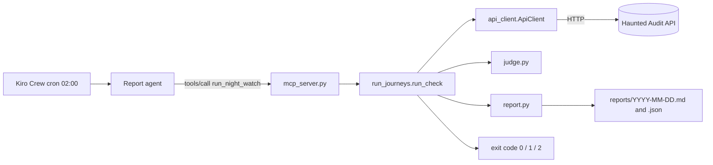
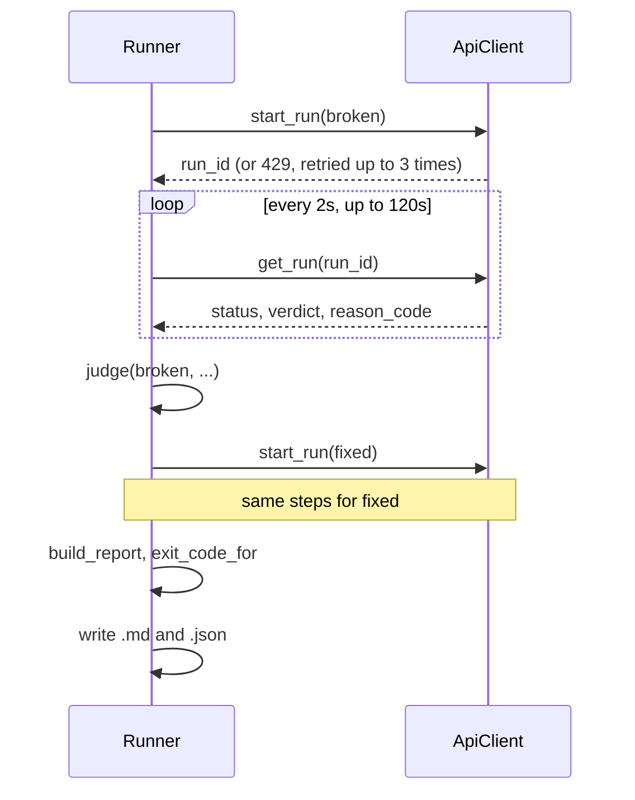

# Design Document: Night Watch

## Overview

Night Watch re-runs the Send Payment journey every night at 02:00 through the Haunted Audit API, in scripted mode only. The broken variant must come back BLOCKED and the fixed variant must come back PASSED. A fixed variant that comes back BLOCKED is reported as a "returning ghost". Anything Night Watch cannot trust (crashed run, timeout, outage, odd response) is reported as "could not check", never as a pass or a ghost.

The design splits the work into small files. Pure logic (config, judging, exit codes, report building and rendering) is separate from the I/O parts (HTTP, clock, file writing, stdio). The pure parts are tested with example tests, plus two Hypothesis tests (exit code priority and the report JSON round trip). The I/O parts are tested with a fake API and a fake clock, so no test opens a network connection or waits in real time.

Key decisions:

| Decision | Rationale |
|---|---|
| Inject `ApiClient` and `Clock` into the Runner | Tests use a Fake_API and a recorded fake clock (Requirement 12.2, 12.3). |
| Judging is one pure function `judge()` | Requirements 3 and 4 become one property-testable unit. |
| API text never goes into report prose directly | Reason codes map to fixed plain-English sentences, so a report can never contain a "WCAG compliant" claim from API data (Requirement 8.10). |
| Runner is a library plus a thin `main()` | The MCP server calls the same function; no second implementation. |
| Standard library plus `requests`, and the official `mcp` package for the MCP server | Workspace tech rule, with one deliberate exception for `mcp` (user decision), so no JSON-RPC is written by hand. |

Research notes: the API facts come from `docs/api-contract.md` (read only). The MCP server uses FastMCP from the official `mcp` package over stdio, which closes assumption A3. The Kiro Crew manifest shape (A1, A2) and the broken-variant-PASSED rule (A4) are confirmed by the user. `night_watch/` is the app folder installed in Crew, so every path in `app.json` is relative to it.

## Architecture



Flow of one check:



### File layout

All files stay small (target under 150 lines each).

| File | Purpose |
|---|---|
| `night_watch/config.py` | Read and clean `HA_API_URL`. |
| `night_watch/models.py` | Dataclasses and constants for results. |
| `night_watch/api_client.py` | `ApiClient` (requests) and the error types. |
| `night_watch/judge.py` | Pure `judge()` and `exit_code_for()`. |
| `night_watch/retry.py` | Pure `parse_retry_after()`. |
| `night_watch/report.py` | `build_report()`, `render_markdown()`, `write_report()`. |
| `night_watch/run_journeys.py` | `run_check()` orchestration and `main()`. Exists as a stub. |
| `night_watch/mcp_server.py` | FastMCP stdio server with one tool, `run_night_watch`. |
| `night_watch/app.json` | Kiro Crew manifest. Exists as `{}`. |
| `night_watch/skills/night-watch-report/SKILL.md` | Report skill (A2). Frontmatter: `name`, `description`, `triggers`. |
| `night_watch/report_agent/agent.json` | Agent file for the Report_Agent. Fields: `name`, `model` (`auto`), `description`, `prompt` (the text of `prompt.md`, inline), `tools`. |
| `night_watch/report_agent/prompt.md` | Agent prompt. Exists. |
| `night_watch/tests/` | `fakes.py`, plus test files per module. |

The requirements name `night_watch/tests/test_run_journeys.py` as the suite file. Additional test files may sit beside it; `pytest night_watch/tests` runs all of them.

## Components and Interfaces

### config.py

```python
DEFAULT_API_URL = "http://127.0.0.1:8000"

class ConfigError(ValueError): ...

def normalize_api_url(raw: str | None) -> str:
    """None, empty or whitespace -> default. Strip whitespace and trailing slashes.
    Raise ConfigError unless the result starts with http:// or https://."""

def read_api_url(environ=os.environ) -> str:
    """Return normalize_api_url(environ.get("HA_API_URL"))."""
```

Requirement 1.2 says blank means default, and 1.4 says a bad scheme stops the run with exit code 2. `main()` catches `ConfigError`, prints "HA_API_URL is invalid: it must begin with http:// or https://" to stderr, and returns 2 before any request is sent. No report is written in this case, because no check ran.

### models.py

```python
VARIANTS = ("broken", "fixed")
EXPECTED = {"broken": "BLOCKED", "fixed": "PASSED"}

@dataclass(frozen=True)
class RunSnapshot:            # one GET /runs/{id} answer, values kept as received
    status: object
    verdict: object
    reason_code: object

@dataclass(frozen=True)
class VariantResult:
    variant: str              # "broken" | "fixed"
    run_id: str | None
    status: str | None
    verdict: str | None
    reason_code: str | None
    result: str               # "as_expected" | "returning_ghost" | "could_not_check"
    explanation: str          # plain English, 1 to 500 characters
```

### api_client.py

```python
class ApiUnreachable(Exception): ...      # refused, DNS failure, or 10 s timeout
class ApiBadResponse(Exception): ...      # HTTP >= 400 (not 429), bad JSON, missing field
class RateLimited(Exception):             # HTTP 429
    retry_after: str | None               # raw header text

class ApiClient:
    def __init__(self, base_url: str, session=None, timeout: float = 10.0): ...
    def start_run(self, variant: str) -> str:        # POST /runs, returns run_id
    def get_run(self, run_id: str) -> RunSnapshot:   # GET /runs/{run_id}
```

`start_run` sends exactly `{"variant": variant, "mode": "scripted"}`. It raises `ApiBadResponse` for any status other than 202 (except 429), and for a 202 without `run_id`. Request URLs are built as `base_url + "/runs"`, so a cleaned base URL never produces a double slash.

### Clock

```python
class Clock(Protocol):
    def sleep(self, seconds: float) -> None: ...
    def now(self) -> float: ...        # monotonic seconds, used for the 120 s timeout
```

Production uses `time.sleep` and `time.monotonic`. Tests use `FakeClock`, where `sleep` advances `now` and appends to a `sleeps` list.

### retry.py

```python
def parse_retry_after(value: str | None) -> int | None:
    """Return the wait in seconds if value is a whole number 0..120 (digits only),
    otherwise None. Negative, decimal, empty, missing or over-120 values give None."""
```

### judge.py

```python
def judge(variant: str, snapshot: RunSnapshot) -> VariantResult:
    """Apply Requirements 3 and 4 to one finished or errored snapshot.

    status == "error"                          -> could_not_check
    status not in {"complete"}                 -> could_not_check (unknown status)
    verdict not exactly "PASSED" or "BLOCKED"  -> could_not_check
    broken + BLOCKED                           -> as_expected
    broken + PASSED                            -> could_not_check, explanation exactly
                                                  BROKEN_STILL_PASSES (A4)
    fixed  + PASSED                            -> as_expected
    fixed  + BLOCKED                           -> returning_ghost (reason_code verbatim,
                                                  or "no reason given")
    """

def exit_code_for(results: Sequence[VariantResult]) -> int:
    """1 if any returning_ghost, else 2 if any could_not_check, else 0."""

def outcome_for(results) -> str:
    """'returning_ghost' | 'could_not_check' | 'all_as_expected' with the same priority."""
```

`BROKEN_STILL_PASSES` is a constant in `models.py` with the value `"Broken variant no longer blocks: the checker or test page changed"`. `report.py` writes it unchanged into the JSON `explanation` and the Markdown, and it is never marked as a returning ghost.

`judge` never reads `verdict` while `status` is not `complete`. `running` is never passed to it, because the Runner keeps polling while status is `running`.

### report.py

```python
def build_report(checked_at: datetime, api_url: str, results: Sequence[VariantResult],
                 exit_code: int) -> dict
    # exactly: checked_at, api_url, mode, journey, outcome, exit_code, variants

def render_markdown(report: dict) -> str

def write_report(report: dict, reports_dir: Path) -> tuple[Path, Path]
    # creates the folder, overwrites both files for the same UTC date
```

Notes:

- `checked_at` is a UTC ISO-8601 string ending in `Z`. The file date is its first 10 characters.
- `mode` is `scripted` and `journey` is `send-payment`.
- Reason codes map to fixed sentences, for example `TARGET_NOT_FOCUSABLE` becomes "the pay button could not be reached with the keyboard". An unknown code is shown as "an unrecognised reason code (CODE)" with the code placed inside quotes. This keeps free text from the API out of the prose.
- The Markdown always contains the words "scripted mode" and the sentence that scripted mode follows a fixed script and does not use an AI model. It never contains "WCAG" next to a compliance word. The text says "This is not a WCAG compliance check" is avoided too, to keep the rule simple. The words simply do not appear.
- Explanations are truncated to 500 characters and are never empty.
- JSON is written with `ensure_ascii=False` and UTF-8, so non-ASCII text round-trips.
- Rate-limit waits (Requirement 5.5) are recorded in each variant's `explanation` text, for example "waited 5 s before retry 1 of 3". The JSON field set stays exactly as Requirement 8.5 and 8.6 define it.

### run_journeys.py

```python
def run_check(client, clock, reports_dir: Path, api_url: str,
              now_fn=lambda: datetime.now(timezone.utc)) -> tuple[int, dict, tuple[Path, Path]]:
    """Check both variants in order, write the report, return exit code, report, paths."""

def main(argv=None) -> int:
    """Read config, build ApiClient and real clock, call run_check, print one summary
    line, return the exit code. Catches every exception and returns 2."""
```

Per-variant steps inside `run_check`:

1. `start_run` with the 429 loop: on `RateLimited`, `parse_retry_after`. If None, could_not_check ("Retry-After value was unusable"). If the retry count is already 3, could_not_check ("rate-limit retry limit of 3 retries was reached"). Otherwise sleep that many seconds and retry.
2. Poll: record start time, then loop. `get_run`. If status is `complete` or `error`, call `judge`. If status is `running`, check elapsed against 120 s, then `clock.sleep(2)`. Any other status goes to `judge`, which classes it as could_not_check. Three failed polls in a row end in could_not_check.
3. `ApiUnreachable` at any step: this variant and every variant not yet checked become could_not_check, and no more requests are sent (Requirement 6.1). `ApiBadResponse`: only this variant is affected.

Timeout counting: elapsed time since the 202 response is measured with `clock.now()`. The Runner gives up when elapsed plus the next sleep would exceed 120 s, so total fake waiting for one run never exceeds 120 s.

The fixed run starts only after the broken run is finished or classified (Requirement 2.3), so at most one run is active and at most 2 runs are started per invocation. A 429 retry repeats the same POST that was refused, so it does not create an extra run.

Unexpected exceptions: `run_check` wraps the loop. On an exception it builds a report listing any unchecked variant as could_not_check with the exception type and a plain-English sentence, writes it, and returns 2. If writing fails, `main()` prints the exception type to stderr and returns 2. A report-write failure in the normal path prints one line naming the path and cause, and returns 2 (Requirement 8.3).

### mcp_server.py

Built on the official `mcp` Python package (FastMCP, stdio transport). The package handles JSON-RPC framing, the `initialize` handshake, `tools/list`, unknown tools and invalid input. No protocol code is written by hand.

```python
mcp = FastMCP("night-watch")

def build_summary(exit_code: int, report: dict, paths) -> str:
    """Plain text: outcome, exit code, one explanation per variant, report path."""

@mcp.tool()
def run_night_watch() -> str:
    """Run the nightly check once and return the summary text."""

def main() -> None:
    mcp.run(transport="stdio")
```

- The server is named `night-watch` and offers exactly one tool, `run_night_watch`, with no arguments.
- The tool function calls `run_check` once with the real client, clock and config, then returns `build_summary(...)`. Exit code 1 or 2 is still a normal result, not an error.
- An exception from the runner is reported by the package as an error for that call, and the server keeps running.
- Only the package writes to stdout. `run_check` prints nothing, and diagnostics go to stderr.
- The test calls the `run_night_watch` function directly with a runner stub, so no stdio or protocol is involved.

### Manifest, skill and prompt

`night_watch/app.json` has only these top-level fields: `name` (`night-watch`), `version` (`0.1.0`), `displayName` (`Night Watch`), `description`, `author`, `license` (`MIT`), `agents`, `skills`, `mcpServers`, `crons`.

```json
{
  "name": "night-watch",
  "version": "0.1.0",
  "displayName": "Night Watch",
  "description": "...",
  "author": "...",
  "license": "MIT",
  "agents": ["report_agent/agent.json"],
  "skills": ["skills/night-watch-report"],
  "mcpServers": {
    "night-watch": {"command": "python", "args": ["mcp_server.py"], "env": {}}
  },
  "crons": [
    {"name": "nightly-check", "cron_expr": "0 2 * * *", "message": "...", "agent": "report_agent"}
  ]
}
```

- `night_watch/` is the app folder installed in Crew, so every path in `app.json` is relative to it.
- `agents` is a list with exactly one path, `report_agent/agent.json`. The agent file has only `name`, `model` (`auto`), `description`, `prompt` and `tools`. `prompt` holds the full text of `prompt.md` inline, and `tools` allows only `run_night_watch`.
- `skills` is a list with exactly one skill folder path. The folder holds `SKILL.md` whose frontmatter has `name`, `description` and `triggers`.
- `mcpServers` uses the `mcp.json` format with one entry that defines `command` (`python`), `args` (`["mcp_server.py"]`, relative to `night_watch/`) and `env`. `env` carries no secrets and no API address; the server inherits `HA_API_URL` from the environment.
- `crons` is a list with one entry with `name`, `cron_expr`, `message`, `agent`. `agent` names the Report_Agent. The `message` says: call `run_night_watch` exactly once; on `all_as_expected` reply with exactly one line of plain text and take no further action; on `returning_ghost` or `could_not_check` follow `report_agent/prompt.md`.
- Neither `app.json` nor `agent.json` holds secrets, real data or a hard-coded API address.

The exact string values for `name` and `agent` inside the cron entry follow the Report_Agent name chosen in `agent.json`; a smoke test checks the two match.

The prompt and skill hold the rules from Requirement 11. All example data is synthetic.

## Data Models

Report JSON (exact field set):

```json
{
  "checked_at": "2026-11-24T02:00:03Z",
  "api_url": "http://127.0.0.1:8000",
  "mode": "scripted",
  "journey": "send-payment",
  "outcome": "all_as_expected",
  "exit_code": 0,
  "variants": [
    {"variant": "broken", "expected_verdict": "BLOCKED", "run_id": "run-1",
     "status": "complete", "verdict": "BLOCKED", "reason_code": "TARGET_NOT_FOCUSABLE",
     "result": "as_expected", "explanation": "The broken variant was blocked, as expected."},
    {"variant": "fixed", "expected_verdict": "PASSED", "run_id": "run-2",
     "status": "complete", "verdict": "PASSED", "reason_code": null,
     "result": "as_expected", "explanation": "The fixed variant passed, as expected."}
  ]
}
```

Result classification table:

| Variant | status | verdict | result |
|---|---|---|---|
| broken | complete | BLOCKED | as_expected |
| broken | complete | PASSED | could_not_check |
| fixed | complete | PASSED | as_expected |
| fixed | complete | BLOCKED | returning_ghost |
| any | error | any | could_not_check |
| any | complete | other or missing | could_not_check |
| any | other or missing | any | could_not_check |

Exit codes: 1 if any returning ghost, else 2 if any could not check, else 0.

## Correctness Properties

*A property is a characteristic or behavior that should hold true across all valid executions of a system-essentially, a formal statement about what the system should do. Properties serve as the bridge between human-readable specifications and machine-verifiable correctness guarantees.*

Only two behaviours are tested with Hypothesis. All other behaviour is covered by example tests, listed under Testing Strategy.

### Property 1: Exit code and outcome priority

*For any* pair of variant results, `exit_code_for` returns 1 if either is a returning ghost, otherwise 2 if either is could_not_check, otherwise 0, and the result is always in {0, 1, 2}. `outcome_for` agrees with the same priority. *For any* status and verdict, judging the fixed variant and then calling `exit_code_for` gives 1 if and only if the status is `complete` and the verdict is `BLOCKED`. It gives 2 for status `error` (with any verdict), a null verdict, or any verdict other than `PASSED` or `BLOCKED`. It gives 0 only for `complete` with `PASSED`. A broken variant with PASSED gives 2 and never a returning ghost.

**Validates: Requirements 7.1, 7.2, 7.3, 7.6, 12.10**

### Property 2: Report JSON round trip

*For any* valid result set, writing the report JSON and reading it back gives an equal dict, including null values and non-ASCII text in `explanation`.

**Validates: Requirements 8.12, 12.11**

## Error Handling

| Situation | Behaviour | Exit |
|---|---|---|
| `HA_API_URL` has a bad scheme | Print "HA_API_URL is invalid", send nothing | 2 |
| API unreachable or 10 s no answer | This and later variants could_not_check; report written | 2 (or 1 if a ghost was already found) |
| HTTP 4xx/5xx other than 429, bad JSON, missing field | This variant could_not_check; next variant still checked | 2 |
| 429 with usable `Retry-After` | Wait, retry, up to 3 retries | - |
| 429 with unusable header, or 4th 429 | This variant could_not_check, reason recorded | 2 |
| Run `status` is `error` | could_not_check, verdict ignored | 2 |
| Run still `running` after 120 s | could_not_check, "timed out" | 2 |
| Three poll failures in a row | could_not_check | 2 |
| Broken variant PASSED | could_not_check, explanation "Broken variant no longer blocks: the checker or test page changed" (A4) | 2 (or 1 if the fixed variant is a ghost) |
| Unexpected exception | Report written with exception type and plain description | 2 |
| Report cannot be written | One stderr line naming the path and cause | 2 |
| MCP: bad JSON or unknown tool | Handled by the `mcp` package; server keeps running | - |
| MCP: runner exception | Error result for that call; server keeps running | - |

The MCP server never lets a Runner exit code of 1 or 2 become a protocol error.

## Testing Strategy

Two behaviours use Hypothesis with pytest: Property 1 (exit code and outcome priority, test file `test_exit_codes.py`) and Property 2 (report JSON round trip, `test_report_roundtrip.py`). Each is one test with `@settings(max_examples=100)` and a comment tagged `Feature: night-watch, Property N: <title>`. Everything else uses example tests, so the suite stays small and fast.

Test doubles (in `night_watch/tests/fakes.py`):

- `FakeApi`: implements the `ApiClient` interface from a scripted list of responses or exceptions per variant, and logs each call. It opens no network connection.
- `FakeClock`: `sleep` records the duration and advances `now`. No test waits in real time. Each test stays under 5 seconds.
- Synthetic data only: run ids like `run-1`, URLs on `127.0.0.1`.
- Report tests write to pytest's `tmp_path`.

Example tests in `night_watch/tests/test_run_journeys.py` (task 6.7):

- Exit codes: broken BLOCKED and fixed PASSED gives exit 0. Fixed BLOCKED gives exit 1 and "returning ghost" in the Markdown. A refused connection gives exit 2 and both files exist. A run stuck in `running` gives exit 2 with at most 120 s of fake sleep. A 429 with `Retry-After: N` sleeps exactly N. Status `error` with verdict BLOCKED gives exit 2. Broken PASSED gives exit 2, the exact explanation text, and no returning ghost (4.4).
- A parametrized table over fixed-run status and verdict checks the 12.10 rule.
- Unexpected exception gives exit 2 and a report with the exception type (7.4). A report-write failure gives exit 2 (7.5, 8.3). `main` prints exactly one summary line (8.11). A bad `HA_API_URL` (for example `ftp://x`) returns 2, sends no request, writes no report, and prints a message naming `HA_API_URL` (1.4).
- Cases moved from the removed property tests:
  - Config and URLs: blank and whitespace give the default, ` http://x/// ` gives `http://x`, `ftp://x` is rejected. Request URLs have no `//` after the host. The POST body is exactly `{"variant": ..., "mode": "scripted"}`.
  - Retry-After: "5", "0" and "120" give numbers. "121", "-1", "1.5", "", "abc" and None give None.
  - Judging: the expected-outcome table, the exact `BROKEN_STILL_PASSES` text, "no reason given" for an empty reason code, and could_not_check for status `error`, an unknown status, a lowercase verdict and a None verdict.
  - Polling: two `running` answers then `complete` give 3 GET calls and two 2 s sleeps.
  - Rate limit: three 429s then a 202 sleep exactly the `Retry-After` values and complete. A fourth 429 gives could_not_check and the fixed variant is still checked. An unusable header gives no sleep.
  - Sequencing: broken POST before fixed POST, at most 2 runs, and a broken failure does not change the fixed result.
  - Failures: HTTP 500, invalid JSON, a missing `run_id` and three poll failures in a row give could_not_check for that variant only. A refused connection on broken also marks fixed could_not_check with no further request.
  - Report: exact JSON keys, `checked_at` ends in `Z`, "scripted mode" and the no-AI-model sentence present, no "WCAG" next to a compliance word even with a hostile reason code, unknown reason codes shown quoted, and two writes for the same date leave only the second report.

MCP test (task 8.5): call the `run_night_watch` tool function directly with a runner stub. Check the summary for exit codes 0, 1 and 2, and that a raising stub is reported as an error (12.12). The `mcp` package's own protocol behaviour is not retested.

Smoke tests (task 9.5, optional):

- `app.json` parses as JSON, has only the top-level fields `name`, `version`, `displayName`, `description`, `author`, `license`, `agents`, `skills`, `mcpServers`, `crons`, and has the required values (9.1, 9.2, 9.11).
- `agents` is a one-item list with the path `report_agent/agent.json`. That file has only `name`, `model`, `description`, `prompt` and `tools`, with model `auto` and `prompt` equal to the text of `prompt.md` (9.3, 9.4).
- `skills` is a one-item list with the path `skills/night-watch-report`, whose folder holds `SKILL.md` with frontmatter `name`, `description`, `triggers` (9.5).
- `mcpServers` has one entry with `command`, `args` (`["mcp_server.py"]`) and `env` (9.6).
- `crons` has one entry with `name`, `cron_expr` `0 2 * * *`, `message`, `agent`. The message tells the agent to call `run_night_watch` once, reply with one line on `all_as_expected`, and follow `prompt.md` otherwise. `agent` matches the `name` in `agent.json` (9.7 to 9.10).
- `app.json` and `agent.json` contain no secrets and no API address (9.12).
- The prompt and skill files contain the required rules and the word "synthetic" (11.x).
- Source files contain no `os.path` string joins for report paths and no credentials (1.5, 1.6).

Run command: `pytest night_watch/tests` with the existing `.venv`, on Windows and Linux.
